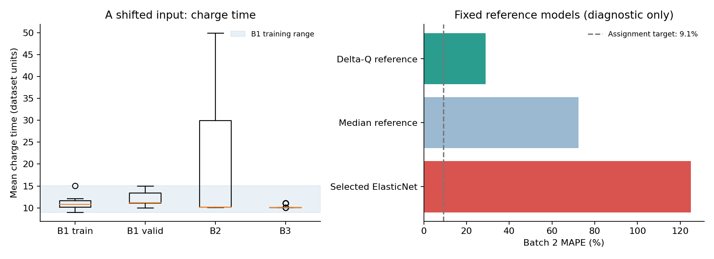

# ESS 배터리 수명 예측 — DAY2

**김도현 | 2026-10-02 | Regression: 초기 100사이클 → 전체 Cycle Life**

초기 운전 데이터로 배터리 수명을 예측하고, 다른 실험 배치에서도 예측이 유지되는지 평가한다.
Batch 1 교차검증에서 선택한 ElasticNet은 MAPE **6.66%**였지만, Batch 2에서는 **124.99%**로 일반화에 실패했다.
과제 목표 9.1%에 도달하지 못했다. 충전 시간 등 입력의 배치 차이를 진단하고, 성능과 실패 원인을 함께 보고한다.

## 먼저 볼 파일

- [VS Code 실행 및 GitHub 업로드 안내](VSCode-실행안내.md) — `main.py` 실행 또는 F5 디버깅
- [실행 결과가 포함된 DAY2 노트북](30-ESSHealth-DAY2-complete.ipynb)
- [과제 양식 성능표](results/model_performance.csv)
- [모델 후보 비교](results/model_comparison.csv)
- [Batch 2 셀별 오류](results/largest_errors_batch2.csv)

## 프로젝트 개요와 데이터

- 데이터: MIT–Stanford Battery Dataset 계열의 원본 MAT 3개. 파일 버전·해시는 [source_manifest.json](data/processed/source_manifest.json)에 기록했다.
- 학습: Batch 1, `2017-05-12` / 필수 테스트: Batch 2, `2018-02-20` / 추가 테스트: Batch 3, `2018-04-12`.
- 타깃: MAT에 제공된 `cycle_life`. 100사이클 시점에서 전체 수명을 예측한다.
- 주지표: `MAPE = mean(abs(실제값−예측값)/실제값) × 100`, 낮을수록 좋다.
- 예측 단위: 배터리 셀 1개. 사이클 행을 독립 표본으로 분할하지 않는다.

| Batch | 원본 셀 | 라벨 결측으로 제외 | 사용 셀 | 수명 중앙값 |
|---|---:|---:|---:|---:|
| B1 | 46 | 0 | 46 | 858.5 |
| B2 | 47 | 8 | 39 | 472.0 |
| B3 | 46 | 2 | 44 | 1,005.5 |

DAY1의 요약 CSV는 140셀/유효 라벨 138개였지만, 이번 원본 MAT는 139셀/유효 라벨 129개다.
서로 다른 파일의 셀 번호나 라벨을 합치지 않고, **DAY2는 MAT에서 추출한 피처와 라벨로 통일**했다.
라벨 결측은 대체하지 않았다. 제외 사유는 [cell_audit.csv](data/processed/cell_audit.csv)에 전부 기록했다.
원본 제공의 `cycle_life`를 사용하므로 별도로 마지막 용량에서 EOL을 다시 계산하지 않았다.

## 파일 구조

```text
ESS-Battery-DAY2/
├── README.md
├── main.py                   # 전체 분석 한 번에 실행
├── .vscode/                  # 실행·디버깅·권장 확장 설정
├── ESS-Battery-DAY2.code-workspace
├── 30-ESSHealth-DAY2-complete.ipynb
├── requirements.txt
├── data/
│   ├── README.md
│   └── processed/           # 셀별 피처, 제외 목록, 원본 해시
├── src/
│   ├── features.py          # MAT → 첫 100사이클 피처
│   ├── train.py             # B1 모델 선택, 고정 후 평가
│   ├── plots.py             # 결과 그림과 요약표
│   └── diagnostics.py       # 배치 차이와 기준 모델 진단
└── results/                 # 성능·분할·예측·모델·그림
```

## 실행 방법

Python 3.11에서 실행 확인했다. 압축을 풀고 `ESS-Battery-DAY2` 폴더에서 실행한다.
포함된 피처 CSV로 학습과 평가를 재현할 수 있어, 약 7.7 GiB의 원본 MAT를 다시 받을 필요는 없다.

```bash
python -m venv .venv
source .venv/bin/activate
# Windows: .venv\Scripts\activate
pip install -r requirements.txt
jupyter lab 30-ESSHealth-DAY2-complete.ipynb
```

노트북에서 **Run All**을 누르면 모델과 결과를 다시 생성한다. CLI 실행도 가능하다.

```bash
python main.py
```

각 단계만 실행할 수도 있다.

```bash
python -m src.train
python -m src.plots
python -m src.diagnostics
```

원본부터 피처를 재생성하는 방법은 [data/README.md](data/README.md)를 참고한다.
랜덤 시드와 데이터가 같으면 같은 분할을 사용한다. 학습환경 버전은 `requirements.txt`와 `results/run_summary.json`에 기록했다.

## EDA와 모델 전략의 연결


1. **수명 분포가 배치별로 다르다.** B2 중앙 수명은 B1보다 짧고 B3는 더 길다. 배치를 섞은 무작위 검증만으로 일반화 성능을 판단할 수 없다.
2. **초기 곡선 변화가 수명과 연관된다.** B1 학습 부분집합에서 `log10 Var[ΔQ(V)]`와 수명의 Pearson r은 약 −0.91이다. 이를 한 개 피처 선형 기준 모델과 다변량 모델에 공통 사용한다. 인과관계로 해석하지 않는다.
3. **충전 조건별 평균 수명이 다르다.** 같은 정책의 셀을 그룹으로 묶어 검증한다. 표본 수가 적고 다른 변수와 얽혀 있어 C-rate의 단독 인과효과로 단정하지 않는다.
4. **초기 절대 용량·시간은 배치에 민감할 수 있다.** DAY1의 QD·IR·온도·충전 조건 전략을 Extended 후보로 구현하고, 피처가 적은 후보와 비교한다.
5. **미래 열화 곡선은 입력에서 제외한다.** 전체 곡선에서 찾은 knee 시점이나 최종 용량은 100사이클 시점에 알 수 없다. 이 프로젝트는 knee를 확정적으로 추정한 모델이 아니다.


## 피처 엔지니어링

| 피처 집합 | 구성 | 이유 |
|---|---|---|
| Delta-Q 1개 | `log_dq_var` | 소표본에서 가장 간결한 기준 |
| Core 5개 | Delta-Q 로그 분산·로그 절대 최솟값, QD 기울기, IR 평균, 충전 시간 평균 | 초기 열화와 전기적 변화 요약 |
| Extended 12개 | Core + 초기 QD, QD 변화, IR 변화, 평균 온도, C1/Q1/C2 | DAY1 다변량 가설 검증 |

`ΔQ(V)=Q100(V)−Q10(V)`는 원본의 같은 전압 격자에서 계산한다. 요약 통계는 cycle 2–100만 사용한다.
초기값은 cycle 2–6 평균, 변화량은 cycle 96–100 평균에서 초기 평균을 뺀 값이다.
QD는 고정 범위 0.5–1.3 Ah 밖을 결측으로, IR·충전 시간의 0 이하 값도 결측으로 처리한다.
대체값과 표준화 통계는 각 fold의 학습 데이터에서만 계산한다. 타깃은 log10 수명으로 학습하고 원단위에서 평가한다.

## 모델 선택과 누출 방지

1. B1 정책 그룹의 20%를 `GroupShuffleSplit(random_state=42)`으로 hold-out한다: **학습 35셀/18정책, 검증 11셀/5정책**.
2. 학습 35셀에서 바깥 5-fold GroupKFold로 성능을 측정한다. 하이퍼파라미터는 각 바깥 학습 fold 내부의 최대 4-fold GroupKFold에서만 선택한다.
3. 바깥 fold MAPE의 산술평균이 가장 작은 후보를 선택한다. 동일 CV 결과로 후보를 선택하므로 선택 편향은 남아 있으며, 별도의 hold-out과 외부 평가가 필요하다.
4. 선택한 후보의 하이퍼파라미터를 B1 학습 35셀의 grouped CV로 정하고 모델을 고정한다. B1 hold-out, B2, B3를 본 뒤 재선택하지 않는다.
5. 비교의 일관성을 위해 hold-out 11셀을 합쳐 재학습하지 않는다. Valid/B2/B3 모두 **동일한 35셀 학습 모델**의 평가다.

| 후보 | 피처 수 | B1 CV MAPE (%) | fold 표준편차 (pp) |
|---|---:|---:|---:|
| **ElasticNet Extended — 선택** | 12 | **6.66** | 0.60 |
| Log-linear Delta-Q | 1 | 7.00 | 2.20 |
| ElasticNet Core | 5 | 9.05 | 1.65 |
| Ridge Core | 5 | 9.28 | 1.51 |
| Gradient Boosting Core | 5 | 11.23 | 4.43 |
| 학습 수명 중앙값 | 5¹ | 19.76 | 8.83 |

¹ 중앙값 모델은 입력 컬럼을 받아도 피처 값을 사용하지 않는다.
최종 ElasticNet은 `alpha=0.01, l1_ratio=0.2`다. 표준화 뒤 규제를 적용하며 최종 계수는 `results/model_coefficients.csv`에 있다.
CV 오차막대는 fold 간 표준편차이며 신뢰구간이 아니다.


## 성능 결과 — 과제 양식

| 구분 | MAPE 또는 Gap | 비고 |
|---|---:|---|
| Train (Batch 1 CV) | **6.66%** | B1 학습 부분집합, nested grouped 5-fold 평균 |
| Valid (Batch 1 Hold-out) | **16.48%** | 미사용 정책 5개, 11셀 |
| Test (Batch 2) | **124.99%** | 라벨 보유 39셀, 최종 고정 모델 |
| Gap (Train-Valid) | **+9.82 pp** | Valid − CV |
| Gap (Valid-Test) | **+108.51 pp** | Test − Valid |
| Gap (Target-Test) | **+115.89 pp** | Test − 과제 기준 9.1% |
| External (Batch 3) | **14.53%** | 추가 평가 44셀, 같은 고정 모델 |
| Gap (Batch2-Batch3) | **−110.46 pp** | Batch 3 − Batch 2 |

**부호 정의:** 노션 양식의 `(+) = 오차 악화` 의미에 맞춰 뒤쪽 오차에서 앞쪽 오차를 뺐다.
하이픈을 문자 그대로 뺄셈으로 해석하면 부호가 반대이므로 계산식을 병기했다.
MAPE는 100%를 넘을 수 있다. 수명을 실제보다 두 배 이상 크게 예측하는 셀이 많으면 이번처럼 큰 값이 나온다.

추가 지표: B2 MAE **680.25 cycles**, RMSE **1,061.02 cycles**, R² **−22.40**.
9.1%는 **과제에서 지정한 논문 비교 기준**이다. 이번 MAT 파일·셀 구성·배치별 분할은 논문 원실험과 달라 동일 조건 재현 성능으로 주장하지 않는다.


## 오류 분석과 개선 방향


가장 큰 상대오차 셀은 B2C28, B2C26, B2C30, B2C41, B2C46이다. 실제 수명은 **412–503사이클**인데 **2,040–2,470사이클**로 과대예측했다.
이 셀들은 초기 평균 충전 시간이 약 **49.8**로, B1 학습 범위 **8.99–15.08**을 크게 벗어난다(원본 데이터 단위).
B2의 39셀 중 10셀이 이 충전 시간 범위를 벗어난다.

선택 모델의 충전 시간 계수는 양수다. 표준화된 충전 시간이 매우 커지면서 log10 예측 수명에 최대 약 **+0.52**를 더한다.
이는 다른 피처가 같을 때 약 **3.3배**에 해당한다. `log10_prediction_contributions.csv`에서 셀별 기여를 확인할 수 있다.
배치 간 시간 측정 정의·시험 구조 차이 또는 실험 조건 차이가 원인일 수 있으나, 메타데이터만으로 어느 하나를 확정하지 않았다.
절대 용량·충전 조건의 차이도 있어, 충전 시간만이 모든 오류의 원인이라고 단정하지 않는다.

### 고정된 기준 모델과의 사후 비교

| 모델 | B1 hold-out MAPE | B2 MAPE | B3 MAPE |
|---|---:|---:|---:|
| CV 선택 ElasticNet | 16.48% | 124.99% | 14.53% |
| 수명 중앙값 기준 | 16.49% | 72.40% | 20.23% |
| Delta-Q 1피처 기준 | 18.20% | 28.86% | 12.59% |



두 기준 모델은 처음부터 비교 후보에 있던 무튜닝 모델이다. B2 비교는 실패 원인 해석용이며 **선택 모델을 바꾸지 않았다**.
단순 Delta-Q 모델이 외부 배치에서 더 안정적이었지만 9.1% 목표에는 미달했다.

다음 실험에서는 충전 시간의 단위·정의를 먼저 확인하고, B1 내부에서 입력 범위 제한 또는 배치에 덜 민감한 피처만 사용하는 규칙을 비교할 수 있다.
CV 차이 0.34 pp에 비해 12피처 모델의 복잡성이 큰 점도 검토 대상이다.
다만 B2와 B3를 이미 평가했으므로, 이 결과를 보고 개선한 모델의 최종 일반화 성능은 **새 독립 데이터**로 확인해야 한다.

## ESS 도메인 해석

예측값은 점검 우선순위·예비품·교체 계획의 보조 자료가 될 수 있다.
하지만 이번 선택 모델은 B2 수명을 크게 과대예측했으므로 **현장 적용 가능한 모델로 채택할 수 없다**.
100사이클 시점의 잔여 수명 추정은 `예측 전체 수명−100`이지만 별도로 검증한 RUL 모델은 아니다.
실제 BESS에 적용하려면 현장 데이터, 온도·휴지 시간·달력 열화, 셀 간 편차, 불확실성 구간과 과대예측 비용을 반영해야 한다.
수명 예측은 화재 진단·안전 보증을 의미하지 않는다.

## 검증 및 제출

- 노트북 코드 셀 7개를 위에서부터 실제 실행하고 표·그래프 출력을 저장했다.
- 학습/검증 셀·정책 비중복, 저장 모델 재로딩 예측 일치, 타깃·미래 정보의 피처 제외를 확인했다.
- 원본 데이터 대신 출처와 셀별 가공 피처를 포함해 노트북 재실행이 가능하게 했다.
- **DAY2 제출물은 공개 GitHub 저장소 링크**다. 이 폴더의 파일을 저장소 루트에 업로드한 뒤 링크를 반별 Slack 제출 스레드에 제출한다.
- 저장소의 README 이미지와 노트북 출력이 보이는지 확인한다. `.venv`, 캐시, 원본 `.mat`는 올리지 않는다.
- 이 패키지는 로컬 제출 준비본이며, GitHub 게시나 Slack 제출은 아직 하지 않았다.

## 참고문헌

- [DAY2 과제와 제출 양식](https://actually-war-1ea.notion.site/DS-Mini-Project-32d7f4c8669380338a27f90c471c1fcb#32d7f4c86693803fb821cd121f0c72a0)
- [Severson et al. (2019), Data-driven prediction of battery cycle life before capacity degradation, Nature Energy 4, 383–391](https://doi.org/10.1038/s41560-019-0356-8)
- [저자 공개 데이터 처리 코드](https://github.com/rdbraatz/data-driven-prediction-of-battery-cycle-life-before-capacity-degradation)
- [이번 원본 MAT의 Kaggle 미러](https://www.kaggle.com/datasets/itshpark/data-driven-prediction-of-battery-cycle)

## 작성자

**김도현** — EDA 연계, 피처 엔지니어링, 모델 개발, Batch 2·3 평가 및 오류 분석.
