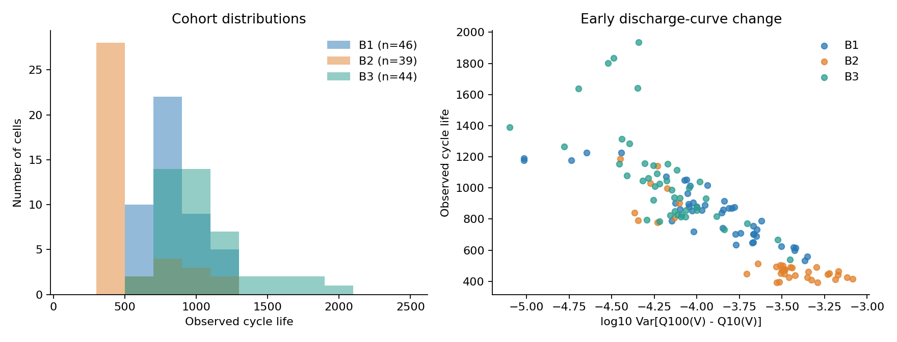
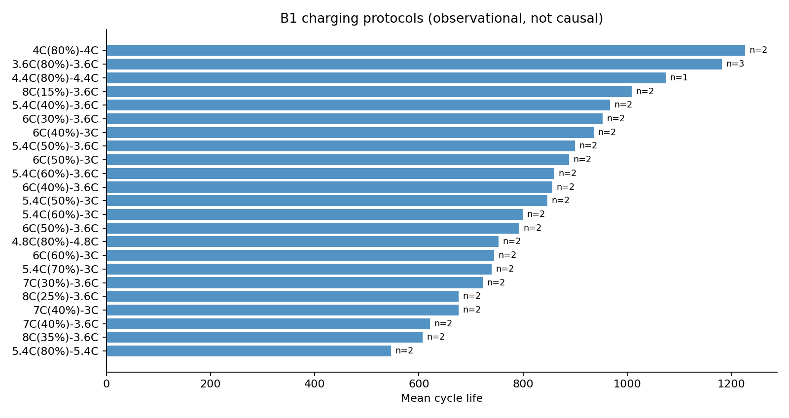
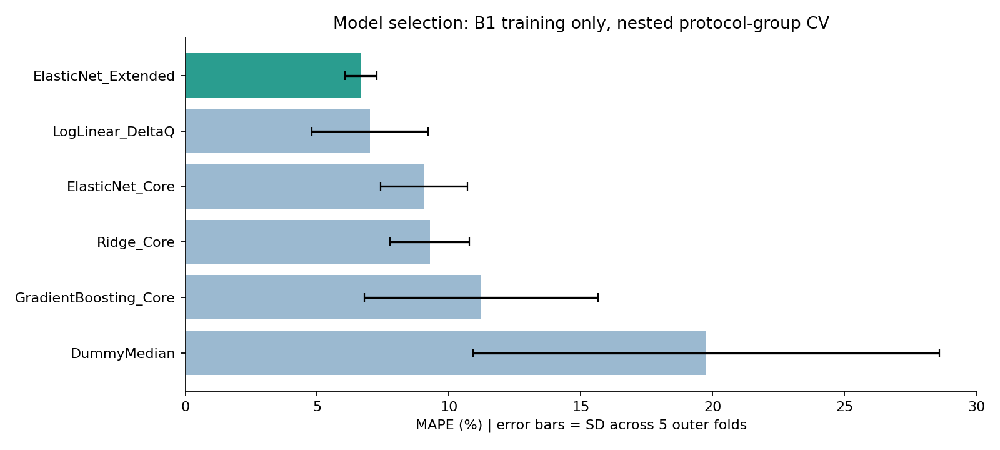
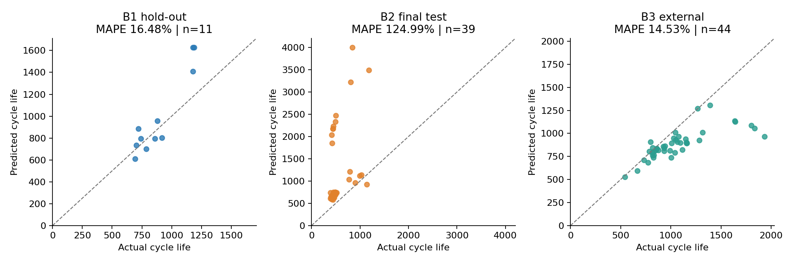
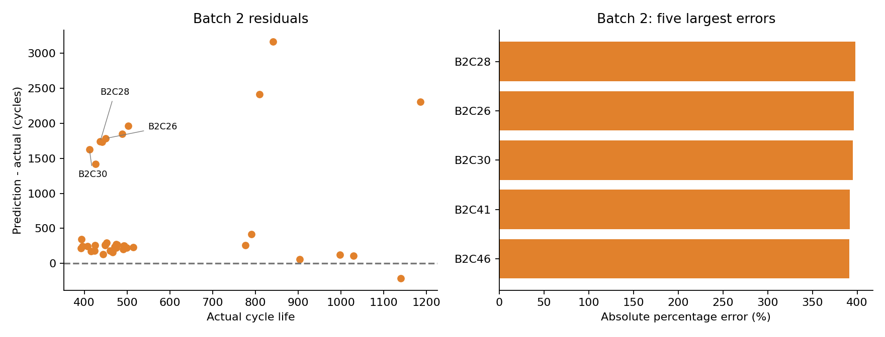

# ESS 배터리 수명 예측

초기 100사이클 데이터로 리튬이온 배터리의 전체 Cycle Life를 예측합니다. Batch 1로 모델을 개발하고 Batch 2에서 최종 성능을 평가했습니다.

## 프로젝트 개요

- 데이터셋: MIT-Stanford Battery Dataset (Severson et al., Nature Energy 2019)
- 학습 데이터: Batch 1 (`2017-05-12`)
- 평가 데이터: Batch 2 (`2018-02-20`)
- 추가 평가: Batch 3 (`2018-04-12`)
- 태스크: Regression (`cycle_life` 예측)
- 입력 범위: Cycle 2-100 및 `Q100(V) - Q10(V)`
- 주 평가 지표: MAPE
- 작성자: 김도현

라벨이 없는 셀은 제외했습니다. 최종 사용 셀은 Batch 1 46개, Batch 2 39개, Batch 3 44개입니다.

## 파일 구조

```text
ESS-Battery-DAY2/
├── 30-ESSHealth-DAY2-complete.ipynb  # 실행 결과가 포함된 분석 노트북
├── main.py                            # 전체 분석 실행
├── requirements.txt                   # Python 패키지 목록
├── data/processed/                    # 셀 단위 피처와 데이터 점검 결과
├── src/
│   ├── features.py                    # 피처 추출
│   ├── train.py                       # 모델 학습과 성능 평가
│   ├── plots.py                       # 결과 시각화
│   └── diagnostics.py                 # Batch 차이와 오류 분석
└── results/                            # 성능표, 예측값, 모델, 그래프
```

## 환경 설정

Python 3.11 환경에서 실행했습니다.

```bash
git clone https://github.com/pu2rile/ess-battery-day2-kimdohyun.git
cd ess-battery-day2-kimdohyun
python3.11 -m venv .venv
source .venv/bin/activate
pip install -r requirements.txt
python main.py
```

Windows에서는 `.venv\Scripts\activate`를 사용합니다. VS Code에서는 `ESS-Battery-DAY2.code-workspace`를 열고 `.venv` 인터프리터를 선택한 뒤 `main.py`를 실행합니다.

포함된 `data/processed/features.csv`로 학습과 평가를 재현할 수 있습니다. 원본 MAT부터 다시 추출하려면 다음 파일을 `data/raw/`에 넣습니다.

```text
2017-05-12_batchdata_updated_struct_errorcorrect.mat
2018-02-20_batchdata_updated_struct_errorcorrect.mat
2018-04-12_batchdata_updated_struct_errorcorrect.mat
```

```bash
python main.py --rebuild-features
```

## EDA

### Cycle Life 분포

- Batch 1 중앙값: 858.5 cycles
- Batch 2 중앙값: 472.0 cycles
- Batch 3 중앙값: 1,005.5 cycles
- 핵심 발견: Batch별 수명 분포 차이가 커서 배치를 섞은 무작위 분할은 일반화 성능을 과대평가할 수 있습니다.



### 열화 곡선 분석

- Cycle 100 이후의 용량과 Knee point는 미래 데이터 누출을 방지하기 위해 모델 입력에서 제외했습니다.
- 초기 QD 기울기, 초기·후기 QD 변화량, IR 변화량으로 Cycle 100 이내의 열화 속도를 요약했습니다.
- 핵심 발견: 초기 절대 용량보다 초기 변화 패턴이 수명 예측에 더 유용했습니다.

### Delta Q(V) 분석

- `Delta Q(V) = Q100(V) - Q10(V)`를 계산했습니다.
- 분산, 최솟값 등 곡선 통계량을 셀 단위 피처로 사용했습니다.
- 핵심 발견: Batch 1 학습 데이터에서 `log10 Var[Delta Q(V)]`와 Cycle Life의 상관계수는 약 -0.91이었습니다.

### 충전 속도와 수명

- C1, Q1, C2 조합별 Cycle Life를 비교했습니다.
- 같은 충전 프로토콜 셀이 Train과 Valid에 동시에 포함되지 않도록 그룹 분할했습니다.
- 핵심 발견: 프로토콜별 평균 수명 차이는 컸지만 표본 수가 작아 인과관계로 해석하지 않았습니다.



## Modeling

### 피처 엔지니어링 전략

| 피처 집합 | 주요 피처 |
|---|---|
| Delta-Q | `log_dq_var` |
| Core | Delta-Q 통계, QD 기울기, IR 평균, 충전 시간 평균 |
| Extended | Core + 초기 QD, QD·IR 변화, 온도, C1/Q1/C2 |

결측치 대체와 표준화는 각 학습 fold에서만 수행했습니다. 타깃은 `log10(cycle_life)`로 변환해 학습하고 예측값은 Cycle 단위로 복원했습니다.

### 모델 선택 및 근거

- 후보 모델: Median Baseline, Log-linear, Ridge, ElasticNet, Gradient Boosting
- 최종 모델: ElasticNet Extended
- 선택 이유: Batch 1 학습 부분집합의 Nested GroupKFold에서 가장 낮은 평균 MAPE 기록
- 하이퍼파라미터: `alpha=0.01`, `l1_ratio=0.2`
- 데이터 분할: Batch 1 Train 35셀 / Hold-out 11셀, Batch 2 Test 39셀
- 누출 방지: 셀과 충전 프로토콜 그룹을 분리하고 Batch 2 결과를 본 뒤 모델을 다시 선택하지 않았습니다.



## 성능 결과

| 구분 | MAPE 또는 Gap | 비고 |
|---|---:|---|
| Train (Batch 1 CV) | 6.66% | Nested grouped 5-fold 평균 |
| Valid (Batch 1 Hold-out) | 16.48% | 미사용 충전 프로토콜 5개 |
| Test (Batch 2) | 124.99% | 최종 고정 모델 |
| Gap (Train-Valid) | +9.82 pp | Valid - Train |
| Gap (Valid-Test) | +108.51 pp | Test - Valid |
| Gap (Target-Test) | +115.89 pp | Test - 논문 비교 기준 9.1% |
| External (Batch 3) | 14.53% | 추가 평가 |

논문 비교 기준인 9.1%에 도달하지 못했습니다. 이번 데이터 파일과 배치 분할은 논문의 원래 실험과 달라 동일 조건의 논문 재현 결과로 주장하지 않습니다.



## 오류 분석

- Batch 2의 주요 과대예측 셀은 실제 수명 412-503 cycles를 2,040-2,470 cycles로 예측했습니다.
- 이 셀들의 초기 평균 충전 시간은 약 49.8로 Batch 1 학습 범위 8.99-15.08을 크게 벗어났습니다.
- Batch 2 39셀 중 10셀의 충전 시간이 학습 범위 밖이었습니다.
- 단일 Delta-Q 기준 모델의 Batch 2 MAPE는 28.86%로 선택 모델보다 안정적이었지만 9.1% 목표에는 미달했습니다.
- 개선 방향: 충전 시간의 단위와 측정 정의 확인, Batch에 덜 민감한 피처 선택, 새로운 독립 평가 데이터 확보가 필요합니다.



## ESS 도메인 해석

초기 운전 데이터 기반 수명 예측은 점검 우선순위, 예비품, 교체 계획 수립에 활용할 수 있습니다. 그러나 이번 최종 모델은 Batch 2 수명을 크게 과대예측했으므로 실제 BESS 운영에 바로 적용할 수 없습니다. 현장 적용 전에는 운전 온도, 휴지 시간, 달력 열화, 셀 편차와 예측 불확실성을 추가로 검증해야 합니다.

## 참고문헌

- Severson et al. (2019). Data-driven prediction of battery cycle life before capacity degradation. *Nature Energy*, 4, 383-391. https://doi.org/10.1038/s41560-019-0356-8
- https://github.com/rdbraatz/data-driven-prediction-of-battery-cycle-life-before-capacity-degradation
- https://actually-war-1ea.notion.site/DS-Mini-Project-32d7f4c8669380338a27f90c471c1fcb

## 팀 구성

- 김도현: EDA, 피처 엔지니어링, 모델 개발, Batch 2·3 성능 평가 및 오류 분석
